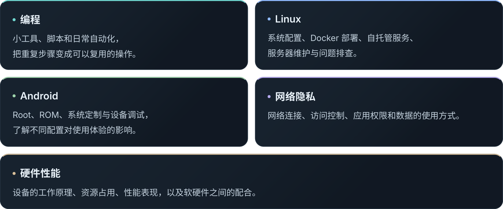

  <picture>
    <source media="(max-width: 640px)" srcset="assets/profile/hero-mobile.png" />
    
  </picture>

### 关于我

喜欢编程，也喜欢研究系统、网络和硬件。碰到有意思的功能，会想弄清它如何实现，再试着用代码或配置把它变成适合自己的工具。

很多兴趣来自日常遇到的问题。把重复操作写成脚本，把常用服务部署起来，或者从日志里找出故障原因，都是我愿意花时间做的事。边使用、边排查、边改进，是我比较习惯的学习方式。

我关心设备的性能，也在意兼容性、稳定性、隐私和使用成本。接触新技术时，会先了解它解决了什么问题，再尝试把它用到自己的日常中。

### 兴趣方向

<picture>
  <source media="(max-width: 640px)" srcset="assets/profile/interests-mobile.png" />
  
</picture>

查看文字版

| 方向 | 感兴趣的内容 |
| :--- | :--- |
| **编程** | 小工具、脚本和日常自动化，把重复步骤变成可以复用的操作。 |
| **Linux** | 系统配置、Docker 部署、自托管服务、服务器维护与问题排查。 |
| **Android** | Root、ROM、系统定制与设备调试，了解不同配置对使用体验的影响。 |
| **网络隐私** | 网络连接、访问控制、应用权限和数据的使用方式。 |
| **硬件性能** | 设备的工作原理、资源占用、性能表现，以及软硬件之间的配合。 |

### 正在学习

- 继续补足编程基础，把零散脚本整理成更容易使用和维护的小工具。
- 学习服务部署、网络排查和日志分析，理解故障背后的原因。
- 探索操作系统与 Android 的工作机制，积累动手验证和调试的经验。

### 习惯与日常

- 遇到问题先尝试复现，再结合日志逐步验证，记录有用的结论。
- 喜欢直接、具体的讨论，也愿意根据实际结果修正自己的判断。
- 使用新工具时，会留意配置是否清楚、出现问题时能否定位，以及后续维护是否方便。

闲下来会玩游戏、关注数码产品，也喜欢从实际使用体验了解设备的性能和设计。

  <picture>
    <source media="(max-width: 640px)" srcset="assets/profile/signature-mobile.png" />
    
  </picture>

